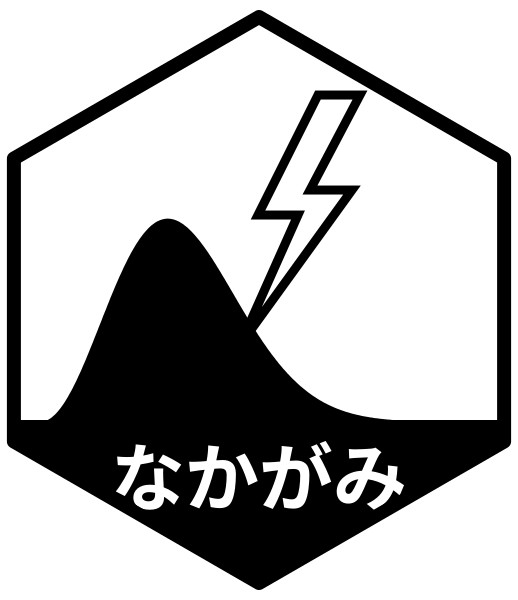
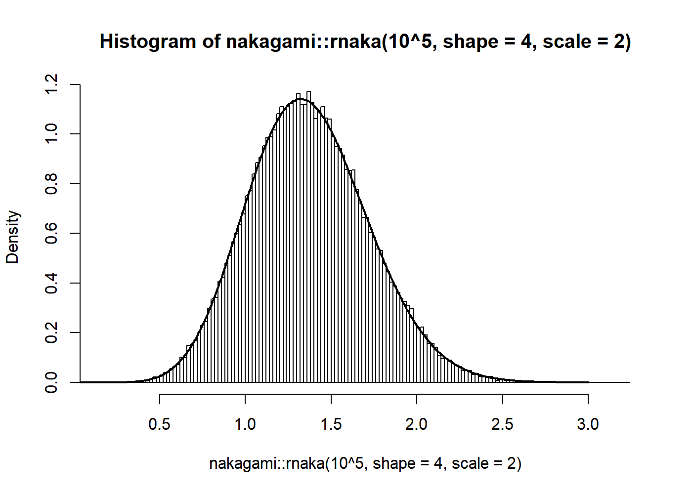

<!-- README.md is generated from README.Rmd. Please edit that file -->

# nakagami 

[](https://github.com/JonasMoss/nakagami/actions)
[](https://www.repostatus.org/#active)
[](https://cran.r-project.org/package=nakagami)

## Overview

An `R`-package for the [Nakagami
distribution](https://en.wikipedia.org/wiki/Nakagami_distribution).

## Installation

Use the following command from inside `R`:

``` r
# install.packages("devtools")
devtools::install_github("JonasMoss/nakagami")
```

## Usage

The density function is `dnaka`, the probability distribution is
`pnaka`, the quantile function is `qnaka` and random deviate generator
is `rnaka`. Use them just like the `*gamma` functions in the `stats`
package.

``` r
set.seed(313)
x = seq(0, 3, by = 0.01)
hist(nakagami::rnaka(10^5, shape = 4, scale = 2), freq = FALSE, breaks = "FD")
lines(x, nakagami::dnaka(x, shape = 4, scale = 2), type = "l", lwd = 2)
```



## Parameterization

If `X` has a Nakagami distribution with parameters `shape` and `scale`,
then `X^2` has a Gamma distribution with the same `shape` and
`rate = shape / scale`. The Nakagami `scale` is therefore `E[X^2]`,
rather than the Gamma scale parameter.

## How to Contribute or Get Help

If you encounter a bug, have a feature request or need some help, open a
[Github issue](https://github.com/JonasMoss/nakagami/issues).

This project follows a [Contributor Code of
Conduct](https://www.contributor-covenant.org/version/1/4/code-of-conduct.html).

## References

- Nakagami, N. 1960. “The m-Distribution, a General Formula of Intensity
  of Rapid Fading.” In Statistical Methods in Radio Wave Propagation:
  Proceedings of a Symposium Held at the University of California, June
  18–20, 1958, edited by William C. Hoffman, 3–36. Permagon Press.
  <https://doi.org/10.1016/B978-0-08-009306-2.50005-4>.
